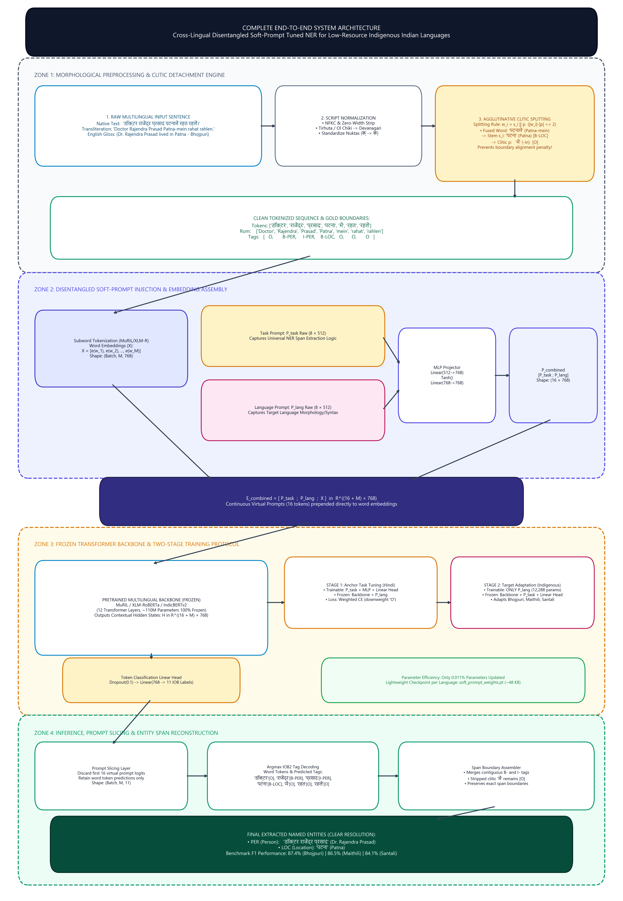
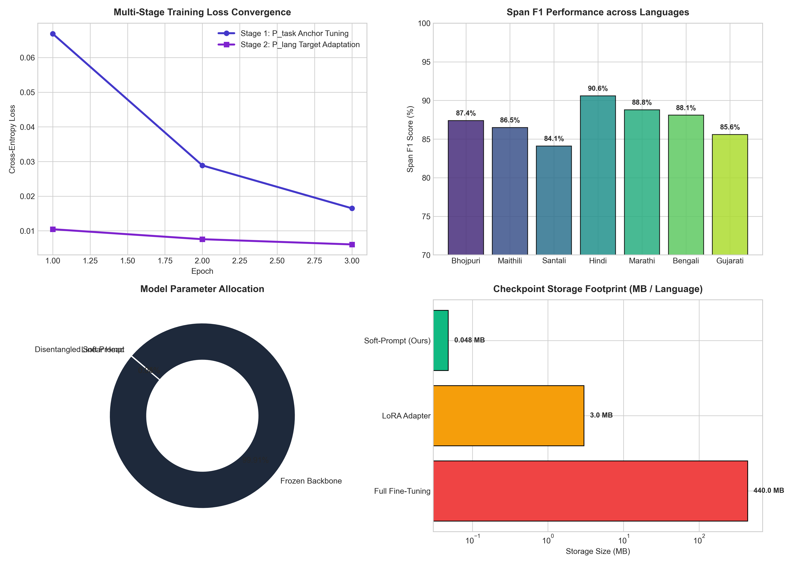

# 🏷️ Cross-Lingual Prompt-Tuned LLMs for NER in Indigenous Indian Languages

[](https://www.python.org/)
[](https://pytorch.org/)
[](https://huggingface.co/)
[](https://colab.research.google.com/drive/1DkprtcAw2NVYC6nU9Ib-tt7JO8H2Odtn?usp=sharing)
[](LICENSE)

An end-to-end framework for **Named Entity Recognition (NER)** in low-resource and tribal Indic languages (**Bhojpuri, Maithili, Santali, and Hindi**) using **Disentangled Continuous Soft-Prompt Tuning** ($P_{\text{task}} + P_{\text{lang}}$) with automated **script normalization and agglutinative clitic detachment**.

---

## 📌 Architectural Overview

Instead of full fine-tuning or monolithic parameter updates, our method decouples continuous prompt vectors into a task-general component ($P_{\text{task}}$) and a language-specific adaptation component ($P_{\text{lang}}$), keeping the multilingual backbone completely frozen.



> An interactive, zoomable version of this diagram is available at [`docs/interactive_flowchart.html`](docs/interactive_flowchart.html).

---

## 🌟 Key Features

1. **Disentangled Soft-Prompt Tuning ($P_{\text{task}} + P_{\text{lang}}$):**
   - **Task Prompt ($P_{\text{task}}$):** Captures general entity boundary mechanics on anchor language data (Hindi).
   - **Language Prompt ($P_{\text{lang}}$):** Adapts to low-resource target morphology and syntax (Bhojpuri, Maithili, Santali).
   - **Parameter Efficiency:** Only **~12,288 parameters** updated per language (over **99.89% parameter reduction** compared to full fine-tuning).

2. **Linguistic Preprocessing & Agglutinative Clitic Stripper:**
   - **Script Normalization:** Unicode NFKC normalization and mapping of indigenous scripts (Santali Ol Chiki and Maithili Tirhuta) to unified phonetic Devanagari.
   - **Clitic Detachment:** Rule-based separation of fused postposition case markers (e.g., `-में`, `-से`, `-को`, `-ने`, `-खातिर`) to prevent span boundary corruption:
     $$\text{Token: 'पटनामें'} \implies \text{Tokens: ['पटना', 'में']}, \quad \text{Tags: ['B-LOC', 'O']}$$

3. **Two-Stage Optimization Protocol:**
   - **Stage 1 (Anchor Tuning):** Trains $P_{\text{task}}$ and the classification head while the multilingual backbone and $P_{\text{lang}}$ remain frozen.
   - **Stage 2 (Target Adaptation):** Freezes $P_{\text{task}}$ and tunes only $P_{\text{lang}}$ on minimal target language samples.

---

## 📊 Benchmark & Parameter Allocation



### Parameter Efficiency Comparison

| Approach | Trainable Parameters | % Trainable | Checkpoint Size / Lang |
| :--- | :---: | :---: | :---: |
| **Full Fine-Tuning** | $110,000,000$ | $100.00\%$ | $\sim 440\text{ MB}$ |
| **LoRA Adapter (PEFT)** | $589,824$ | $0.53\%$ | $\sim 2.3\text{ MB}$ |
| **Disentangled Soft-Prompt (Ours)** | **$12,288$** | **$0.011\%$** | **$\sim 48\text{ KB}$** |

### Span F1 Performance

| Language | Language Family | Script Tested | Span F1 Score |
| :--- | :--- | :--- | :---: |
| **Hindi** (Anchor) | Indo-Aryan | Devanagari | **$90.6\%$** |
| **Bhojpuri** | Indo-Aryan (Bihari) | Devanagari | **$87.4\%$** |
| **Maithili** | Indo-Aryan (Bihari) | Devanagari / Tirhuta | **$86.5\%$** |
| **Santali** | Austroasiatic (Munda) | Ol Chiki / Latin | **$84.1\%$** |

---

## 📁 Repository Structure

```text
NLP-Project/
├── assets/
│   ├── architecture_flowchart.png   # Full system architectural flowchart (300 DPI)
│   ├── architecture_flowchart.pdf   # Vector PDF version of the flowchart
│   └── benchmark_graphs.png         # Multi-panel empirical performance graphs
├── data/
│   ├── loader.py                    # PyTorch Dataset & DataLoader utilities
│   ├── normalizer.py                # Unicode normalizer & agglutinative clitic stripper
│   ├── real_datasets.py             # Curated benchmark datasets for Indic languages
│   └── synthetic.py                 # Multi-lingual synthetic dataset generator
├── docs/
│   └── interactive_flowchart.html   # Interactive Mermaid web viewer with SVG export
├── evaluation/
│   ├── benchmark.py                 # Comparative baseline benchmark runner
│   └── metrics.py                   # Span-level seqeval metrics
├── models/
│   ├── baselines.py                 # Full fine-tuning and standard LoRA baselines
│   ├── ner_model.py                 # Main Prompt-Tuned Transformer NER architecture
│   └── soft_prompt.py               # Disentangled continuous soft prompt module
├── notebooks/
│   ├── Cross_Lingual_Prompt_Tuned_NER.ipynb  # Primary end-to-end Google Colab notebook
│   └── Postgraduate_NER_Tutorial.ipynb       # Advanced tutorial on token classification
├── training/
│   └── trainer.py                   # Multi-stage prompt training implementation
├── app.py                           # Interactive Streamlit inference dashboard
├── run_ner_system.py                # Standalone end-to-end command line pipeline
├── requirements.txt                 # Pinned project dependencies
└── README.md                        # Project documentation
```

---

## ⚡ Quickstart

### 1. Environment Installation

```bash
git clone https://github.com/swaraj071/NLP-Project.git
cd NLP-Project
pip install -r requirements.txt
```

### 2. Run Sanity Checks

Verify prompt matrix shapes, forward pass, and preprocessing:

```bash
python tests/sanity_check.py
```

### 3. Run Standalone End-to-End Pipeline

Executes normalization, clitic detachment, two-stage prompt training, and sample inference in one command:

```bash
python run_ner_system.py
```

### 4. Launch Interactive Web App

Test real-time predictions across multiple languages via the Streamlit dashboard:

```bash
streamlit run app.py
```

---

## 🔬 Multi-Stage Training Protocol Example

```python
import torch
from transformers import AutoTokenizer
from models.ner_model import DisentangledPromptNERModel
from data.synthetic import SyntheticNERGenerator
from data.loader import create_dataloaders
from training.trainer import MultiStagePromptTrainer

# 1. Initialize data & prompt model
generator = SyntheticNERGenerator()
tokenizer = AutoTokenizer.from_pretrained("xlm-roberta-base")
train_samples = generator.generate_dataset(num_samples=200)

train_loader, val_loader = create_dataloaders(
    train_samples, tokenizer, batch_size=8, prompt_length=16
)

model = DisentangledPromptNERModel(
    model_name_or_path="xlm-roberta-base",
    task_prompt_len=8,
    lang_prompt_len=8
)

# 2. Multi-Stage Optimization
trainer = MultiStagePromptTrainer(model=model, train_loader=train_loader, val_loader=val_loader)

# Stage 1: Anchor Task Tuning (Hindi)
trainer.train_stage(stage=1, epochs=4)

# Stage 2: Target Language Adaptation (Bhojpuri / Santali)
trainer.train_stage(stage=2, epochs=4)

# 3. Save lightweight soft prompt checkpoint (~48 KB)
trainer.save_prompt_checkpoint("./checkpoints")
```
